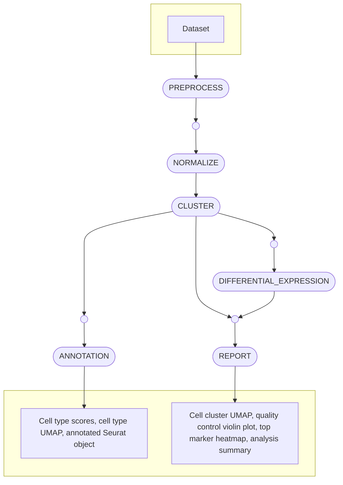

# Single-Cell RNA-seq Analysis Pipeline - BIOF501 Final Project

## Project Background

Many cells contain distinct populations within the same tissue, such as cell types or cell states. Different cell populations can have distinct characteristics, so identifying them is important to understanding cell function. Cell heterogeneity is particularly important in cancer, as cancer cells often have particularly high heterogeneity. Identifying different subpopulations within a tumor can aid in understanding how the tumor behaves and identifying treatment-resistant or aggressive cells. 

Since bulk RNA sequencing measures gene expression across a mixture of cells, it misses differences between individual cells. Single-cell RNA sequencing addresses this by measuring the gene expression of individual cells. This allows researchers to investigate differences between cell populations. 

The goal of this project is to provide a reproducible pipeline for investigating cell types and clustering using single-cell RNA sequencing. The pipeline performs quality control and filtering of the data, normalizes and scales the data, clusters the cells, identifies marker genes associated with each cluster, and predicts the cell type of each cluster. 

By default, this analysis uses a publicly available 10X Genomics scRNA-seq dataset from a breast tumor sample from the Gene Expression Omnibus, under accession number GSE228499, with the goal of identifying transcriptionally distinct cell clusters within the sample, the cell type of those clusters, and the genes that characterize those clusters. 


## Pipeline Design and Rationale

The pipeline includes the following steps:

1. Pre-processing: Cells are filtered according to the number of detected genes and the percentage of mitochondrial RNA. This removes poor quality data such as that from dead/dying cells (which have high mitochondrial RNA), empty droplets (which have low gene counts), and doublets (which have high gene counts).
2. Normalization: SCTransform is used to normalize and scale the data and identify variable features. This helps to distinguish variation introduced by sequencing and sample prep from biological signals. 
3. Dimensionality reduction: Principal component analysis (PCA) is used to identify the main sources of variation.
4. Clustering: A shared nearest-neighbor graph is constructed, allowing graph-based clustering to be conducted. A UMAP is constructed to visualize the results. This allows the identification and visualization of the main transcriptionally distinct groups of cells in the dataset.
5. Differential expression: Cells that have high expression in specific clusters are identified. This allows the identification of marker genes that distinguish the clusters. 
6. Cell annotation: The expression of known marker genes in each cluster is used to assign cell types to the clusters. Clusters that don't meet a minimum score threshold and clusters for which the top two scores are overly similar are labelled as unassigned or ambiguous. 
7. Reporting: Statistics and top marker genes for each cluster are reported, and graphs are produced to visualize the results. 

## Directed Acyclic Graph and Pipeline Summary

The pipeline consists of six stages:
- PREPROCESS
- NORMALIZE
- CLUSTER
- ANNOTATION
- DIFFERENTIAL_EXPRESSION
- REPORT




## Data Overview

The dataset used by default is patient BC_05 from the [GSE228499](https://www.ncbi.nlm.nih.gov/geo/query/acc.cgi?acc=GSE228499) dataset from the Gene Expression Omnibus. This dataset consists of single-cell RNA sequencing data from 9 breast cancer patients. The data was generated using the 10X Genomics Chromium platform and processed using Cell Ranger.

The data consists of 3 files in the [Cell Ranger Feature Barcode Matrices MEX Format](https://www.ncbi.nlm.nih.gov/geo/query/acc.cgi?acc=GSE228499):
- `barcodes.tsv.gz`: cell barcodes
- `features.tsv.gz`: genes/features
- `matrix.mtx.gz`: sparse count matrix

The data contains 2145 cells after filtering with the default quality control parameters of this pipeline. 

The data is included in the GitHub repository in `data/raw/BC_05`.


## Pipeline Dependencies

The following are required to run this pipeline:
- Nextflow (version 26.10.7 recommended)
- Conda
- Java (version 17 or later)
- R

The following R packages are installed automatically through Conda:
- `Seurat`: Single-cell data processing and analysis
- `ggplot2`: Plotting tools
- `dplyr`: Data manipulation
- `tidyr`: Data manipulation
- `patchwork`: Plotting tools


## How To Run

### 0: Install requirements

Ensure that the following are installed:
- Java (version 17 or later): [Installation instructions](https://www.java.com/en/download/help/download_options.html)
- Nextflow: [Installation instructions](https://docs.seqera.io/nextflow/install)
- Conda: [Installation instructions](https://docs.conda.io/projects/conda/en/latest/user-guide/install/index.html)
- Git (to clone the repository): [Installation instructions](https://git-scm.com/book/en/v2/Getting-Started-Installing-Git)

Note: Bash (version 3.2 or later) is required to run Nextflow. If using Windows, use WSL2 and Ubuntu, which can be installed by running the following command in PowerShell: 

```wsl --install```

### 1: Clone the repository

Clone the Git repository by running the following command with Bash:

```git clone https://github.com/rowanharrisstoertz/scrna-pipeline-biof501.git```

Navigate to the project directory:

```cd cancer-scrna-pipeline```

### 2: Add the dataset (optional)

This pipeline uses 10X Genomics single-cell RNA sequencing data. By default, the dataset is sample BC_05 from the breast cancer dataset [GSE228499](https://www.ncbi.nlm.nih.gov/geo/query/acc.cgi?acc=GSE228499) (see the "Data Overview" section for more information). This dataset is included in the Git repository, and no additional set-up is required to run the pipeline on this dataset. 

<details>
<summary>Instructions for using an alternate dataset:</summary>

To use a different dataset, place the files in the directory using the following structure:

```
data  
└── raw  
    └── <sample_id>  
        ├── barcodes.tsv.gz  
        ├── features.tsv.gz  
        └── matrix.mtx.gz  
```

where `barcodes.tsv.gz` contains the cell barcodes, `features.tsv.gz` contains the genes/features, and `matrix.mtx.gz` is a sparse count matrix, following the [Cell Ranger Feature Barcode Matrices MEX Format](https://www.ncbi.nlm.nih.gov/geo/query/acc.cgi?acc=GSE228499). 

Alternatively, `input_dir` may be set to the directory containing the input files (`data/raw` by default).

If running the pipeline with an alternate dataset, ensure that `sample_id` is set to the name of the folder containing the dataset in the directory. 

</details>


### 2: Add a marker gene set (optional)

By default, this dataset uses a set of human breast cell gene markers from [CellMarker](https://bio-bigdata.hrbmu.edu.cn/CellMarker/#/home) for cell-type annotation. This file is included in the Git repository, and no additional set-up is required to run the pipeline using this set of marker genes.

<details>
<summary>Instructions for using an alternate set of marker genes:</summary>

To use a different set of marker genes, place the marker gene file in the directory and set the `marker_file` parameter to the path when running the pipeline (`assets/marker_genes.csv` by default).

The file should be formatted as a .csv file with `cell_type` and `gene` columns.

</details>

### 3: Run the pipeline

To run the pipeline with the default parameters, run the following command in Bash from the project directory:

```nextflow run main.nf```

On my computer, with the default parameters and dataset, the pipeline takes approximately 10 minutes to run. This may vary depending on the dataset, marker genes, and parameters, or on the computer used to run the pipeline. 

Additional parameters can be specified (see below).

<details>
<summary>Parameter details and instructions</summary>

| Parameter | Default | Description |
|---|---|---|
| `sample_id` | `BC_05` | Name/identifier of the sample |
| `input_dir` | `data/raw` | Directory containing the dataset |
| `outdir` | `results` | Directory to save outputs to |
| `marker_file` | `assets/marker_genes.csv` | CSV file containing marker genes for cell type annotation |
| `min_features` | `200` | Minimum number of detected genes |
| `max_features` | `10000` | Maximum number of detected genes |
| `max_percent_mt` | `30` | Maximum mitochondrial gene percentage |
| `n_pcs` | `30` | Number of principal components to calculate in PCA |
| `findneighbors_dims` | `20` | Number of principal components used for FindNeighbors |
| `resolution` | `0.5` | Clustering resolution |
| `umap_dims` | `20` | Number of principal components used for UMAP |
| `umap_min_dist` | `0.1` | Minimum distance parameter for UMAP |
| `annotation_min_score` | `0.5` | Minimum marker score to assign a cell type to a cluster (otherwise classified as "unassigned") |
| `annotation_min_difference` | `0.25` | Minimum difference between the top two marker scores required to assign a cell type to a cluster (if the different is below this threshold, the cluster is classified as "ambiguous") |


The pipeline parameters can either be changed in the `nextflow.config` file or specified when running the pipeline. An example of how to run the pipeline with different parameters (`min_features`, `max_features`, and `max_percent_mt`, in this case) is shown below:

```
nextflow run main.nf \
    --min_features 250 \
    --max_features 15000 \
    --max_percent_mt 25
```

</details>


### Output files

The following output files are generated by the pipeline. They are created in `results/BC_05` by default.
- `<sample_id>_umap.png`: UMAP of identified clusters
- `<sample_id>_qc_violin.png`: Violin plots of quality control metrics (gene counts, feature counts, and mitochondrial percentage) for each cluster
- `<sample_id>_marker_heatmap.png`: Heatmap of the top 10 differentially expressed genes for each cluster
- `<sample_id>_summary.txt`: A summary of statistics about the data and analysis, including a list of the top 10 genes per cluster
- `<sample_id>_annotated_umap.png`: UMAP with cell-type annotations
- `<sample_id>_annotation_scores.csv`: The annotation scores for each cell-type for each cluster 
- `<sample_id>_annotated.rds`: A Seurat object containing the filtered and processed data with cell type annotations added

The GitHub repository contains results generated using the default parameters and dataset in `expected_results` for reference.

## Pipeline Structure

```
cancer-scrna-pipeline
├── README.md
├── assets
│   └── marker_genes.csv
├── data
│   └── raw
│       └── BC_05
│           ├── barcodes.tsv.gz
│           ├── features.tsv.gz
│           └── matrix.mtx.gz
├── envs
│   └── scrna.yml
├── expected_results
│   └── BC_05
│       ├── BC_05_annotated.rds
│       ├── BC_05_annotated_umap.png
│       ├── BC_05_annotation_scores.csv
│       ├── BC_05_marker_heatmap.png
│       ├── BC_05_qc_violin.png
│       ├── BC_05_summary.txt
│       └── BC_05_umap.png
├── main.nf
├── modules
│   ├── annotation.nf
│   ├── clustering.nf
│   ├── differential_expression.nf
│   ├── normalization.nf
│   ├── preprocessing.nf
│   └── reporting.nf
├── nextflow.config
└── scripts
    ├── annotation.R
    ├── clustering.R
    ├── differential_expression.R
    ├── normalization.R
    ├── preprocessing.R
    └── reporting.R
```